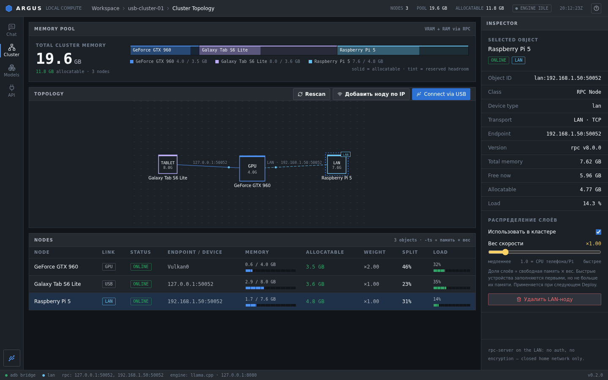

# ARGUS

**Run a local LLM on your GPU plus the old phones in your drawer.**

[Download](../../releases) · [Quick start](#quick-start) · [Support](SUPPORT.md) · [Русский](README.md)

**Built by one person on a GTX 960. If it's useful to you, [chip in for test hardware](SUPPORT.md) ❤️**

## What it is

A decent LLM wants 16–24 GB of VRAM. I have a GTX 960 with 4 GB. But I also have a few old Android phones with 6–12 GB of RAM each.

Argus joins your PC and your phones into one llama.cpp cluster. Phones connect over USB or Wi-Fi, the model's layers are split across the GPU, the PC's CPU and the phones, and you just chat. Everything runs at home: no cloud, no subscription.

No root needed. The phone gets a regular app, Argus Node, which runs llama.cpp's `rpc-server`.

## How it works

Argus benchmarks each device on connect (speed and free memory) and hands out layers so tokens come out as fast as possible. If the model fits in VRAM alone, phones aren't used at all, because that's fastest.

- PC side: Tauri 2 app (Rust + React/TS) running `llama-server` (llama.cpp b12008, Vulkan or CUDA) with `--rpc` pointing at the nodes.
- Phone side: native APK with a static musl `rpc-server`. USB goes through `adb forward` or, since 0.3.4, through USB tethering. On my setup (GTX 960 + phones, Gemma 2 2B) tethering took generation from 16 to 36 tokens/s compared to `adb forward`. Wi-Fi nodes announce themselves via UDP beacon on port 50053.
- Linux PCs and Raspberry Pi can be nodes too: `bash scripts/argus-node-linux.sh`.

## Features

- Plug a phone in, allow USB debugging, and Argus installs the node app and starts it.
- Hugging Face search inside the app, with a "will it fit" check and one-click download.
- Chat with multiple conversations, code blocks, files and live tokens/s.
- OpenAI-compatible API: works with Open WebUI, Jan, Continue, Hermes.
- Speculative decoding: a small draft model on the GPU, the big one verifies.
- MoE models like Qwen3 30B-A3B: experts live on the phones, only a small part of the model works per token.
- Thermal-aware split: a hot phone gets less work.
- Phones as helpers: a small model for titles and summaries, voice input (whisper.cpp), offline Wikipedia (Kiwix .zim) as a tool for the model.
- Chat from any phone on your home network via QR code (PIN-protected), image input, RAG over your folders, overnight queue, Telegram bot.
- Never updates itself silently: every update (PC or phone) asks first and is checked against SHA-256.

## Quick start

1. Get **Argus-Setup.exe** (Windows) or AppImage / .deb (Linux) from [releases](../../releases).
2. On the phone: Settings → About phone → tap "Build number" 7 times → Developer options → **USB debugging**.
3. Plug in the cable and accept the debugging prompt.
4. In Argus press **"Pick a model and start"**.
5. When the status says "Ready", chat.

The installer isn't signed yet, so SmartScreen may complain: "More info" → "Run anyway".

## What fits

| Total memory | Model | Good for |
|---|---|---|
| 4–6 GB | Qwen3 4B | Q&A, translation |
| 8–10 GB | Qwen3 8B, Hermes 3 8B | Code, agent |
| 10–12 GB | Qwen2.5-VL 7B | Images |
| 18 GB+ | Qwen3 30B-A3B (MoE) | Smartest, still fast |

## Security, honestly

llama.cpp's `rpc-server` has no authentication. In Wi-Fi mode and in USB tethering mode the phone listens on port 50052 on all interfaces, so anything on the same Wi-Fi can connect to it. In plain USB mode (adb forward) only the PC can reach it.

So: use Wi-Fi and tethering modes only on your own home network, and never expose ports 50052, 50053, 50061, 50063 or 50080 to the internet. Binding the port to the cable only, or adding a token, is on the roadmap.

## Is it fast?

One big GPU is faster. The point is running models that didn't fit at all before. Phones get warm: take them out of the case and cap charging at 85% if your phone supports it.

## For developers

Architecture and build: [docs/ARCHITECTURE.md](docs/ARCHITECTURE.md). Node roles and protocol: [docs/ROLES.md](docs/ROLES.md) (Russian for now).

Note for anyone shipping static musl servers on Android: patch `accept` → `accept4(..., SOCK_CLOEXEC)`, otherwise seccomp kills the process with SIGSYS on arm64.

## Support

Argus is free and will stay free. If it helped you, [support it here](SUPPORT.md). Everything goes to test hardware.
