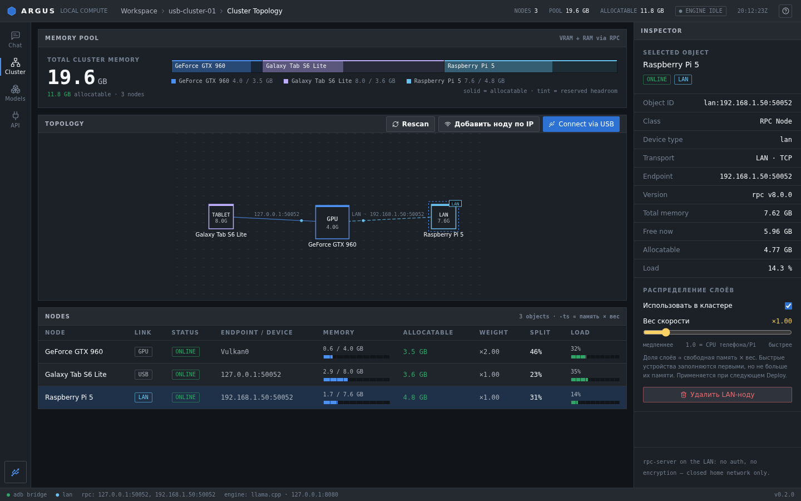
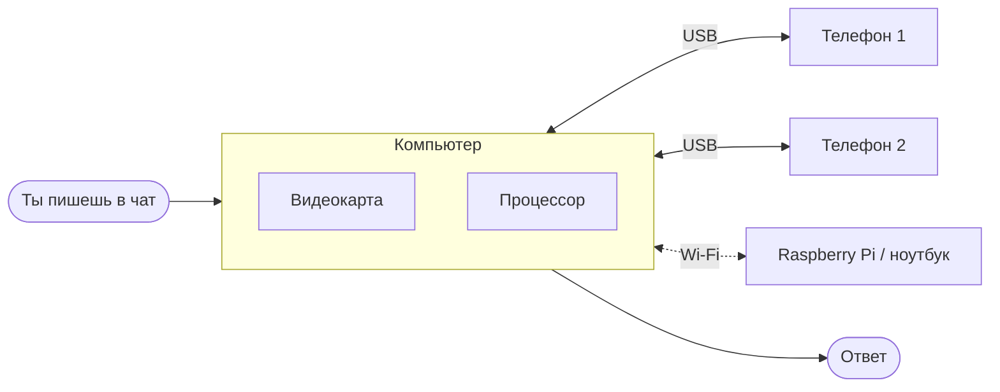
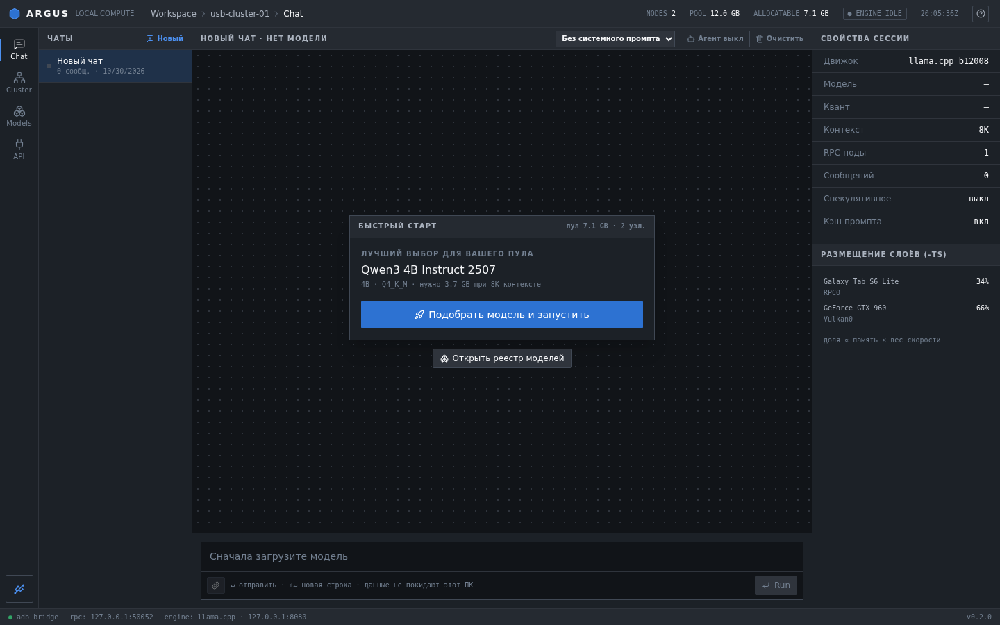
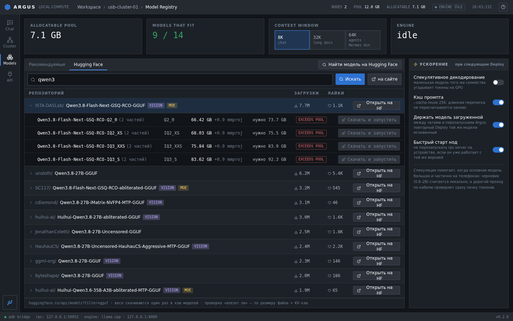
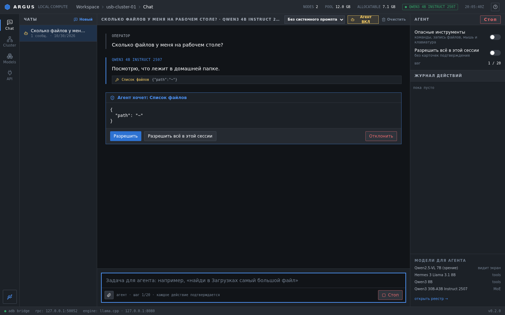
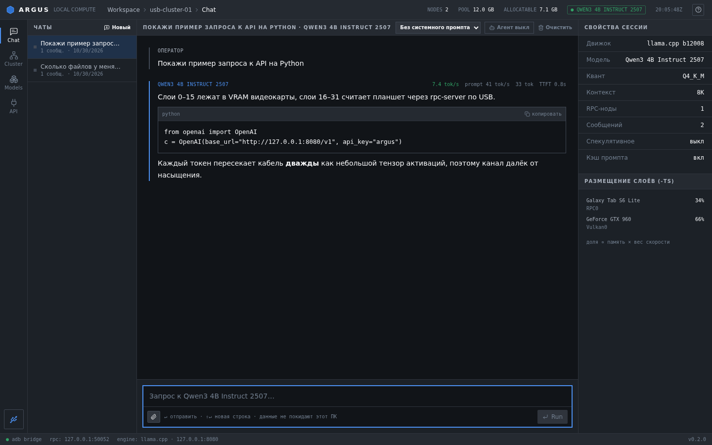

# ARGUS

**Нейросеть у тебя дома: видеокарта плюс старые телефоны.**

[Скачать](../../releases) · [Как запустить](#как-запустить) · [Что нового](#что-нового-в-034) · [Поддержать](SUPPORT.md) · [English](README.en.md)

**Проект делает один человек на GTX 960. Если зашло — [закинь на железо](SUPPORT.md) ❤️**

## Что это

Хорошей нейросети нужно 16–24 ГБ видеопамяти. У меня GTX 960 на 4 ГБ. Зато в ящике лежат телефоны, в каждом по 6–12 ГБ памяти.

Argus соединяет компьютер и телефоны в одну систему. Телефоны подключаются по кабелю или по Wi-Fi, модель сама делится между видеокартой, процессором ПК и телефонами, а ты просто пишешь в чат. Всё работает дома, без интернета и без подписок.

Root не нужен. На телефон ставится обычное приложение Argus Node.

## Как это работает

Нейросеть состоит из слоёв. Argus замеряет, насколько быстрое каждое устройство и сколько у него памяти, и раздаёт слои так, чтобы ответ шёл как можно быстрее. Если модель целиком влезает в видеокарту, телефоны не трогаются вообще: так быстрее всего.

## Что умеет

**Основное**
- Подключил телефон по USB, разрешил отладку. Дальше Argus сам ставит приложение и запускает ноду.
- Модели с Hugging Face: поиск прямо в программе, проверка «влезет или нет», скачивание в один клик.
- Чат с несколькими диалогами, кодом, файлами и скоростью в токенах в секунду.
- API как у OpenAI: подключаются Open WebUI, Jan, Continue, Hermes.
- Агент, который может работать с компьютером. Каждое действие ты подтверждаешь сам.
- Если выдернуть кабель, ничего не зависнет: нода переподключится сама, модель перезапустится.
- Ноды по Wi-Fi находятся сами. Linux-ПК и Raspberry Pi тоже могут быть нодами.
- Обновления только с твоего согласия, ничего не ставится тихо.

**Скорость**
- Тест скорости каждого телефона при подключении.
- Слои делятся по скорости, лишние устройства отдыхают и не греются.
- Процессор компьютера тоже может взять часть слоёв, если он быстрее телефона.
- Ускорение черновиком: маленькая модель на видеокарте угадывает слова наперёд, большая проверяет.
- MoE-модели вроде Qwen3 30B-A3B: эксперты лежат на телефонах, а за один токен работает только малая часть модели.
- Подсказка выбрать Q4_0, если в работе есть телефоны: на их процессорах этот формат быстрее.
- Перегретый телефон получает меньше работы.

**Телефоны в роли помощников**
- **Помощник.** Маленькая модель на свободном телефоне: придумывает названия чатам, пишет сводки и сама отвечает на простые вопросы.
- **Голос.** Телефон распознаёт речь (whisper.cpp): нажимаешь микрофон в чате и говоришь.
- **Библиотека.** Офлайн-Википедия (файл .zim от Kiwix) на старом телефоне. Нейросеть ищет и читает статьи без интернета.

**Новое для повседневки**
- **Чат с телефона.** Argus поднимает страницу в домашней сети: сканируешь QR-код и пишешь с любого телефона. Защищено PIN-кодом.
- **Картинки.** Если модель понимает изображения, к сообщению можно прикрепить фото.
- **Поиск по твоим файлам.** Указываешь папку с документами, и нейросеть отвечает по ним со ссылкой на файл.
- **Ночная очередь.** Ставишь папку на перевод или конспект, утром забираешь результат.
- **Telegram-бот.** Твоя домашняя нейросеть в Telegram, только для тех, кого ты разрешил.
- **Сохранённые сессии.** Длинный чат открывается сразу, не нужно заново читать всю переписку.
- **«Поделиться результатами».** Таблица скорости твоих устройств без серийников, для сравнения с другими.
- Английский интерфейс.

<table>
<tr>
<td> Чат</td>
<td> Модели с Hugging Face</td>
</tr>
<tr>
<td> Агент спрашивает разрешение</td>
<td> Код и форматирование</td>
</tr>
</table>

## Что нового в 0.3.4

- Переключатель «USB-модем» в настройках устройства. Телефон отдаёт сеть по кабелю, и связь идёт напрямую, без adb. Если модем не включён, Argus сам вернётся к обычному режиму и подскажет, где его включить: Настройки → Подключения → Мобильная точка доступа → USB-модем.

## Что было в 0.3.3

- Модель, которая влезает в видеокарту, теперь запускается только на ней.
- Ускорение черновиком (включается в «Моделях»).
- Процессор ПК как отдельная нода.
- MoE-режим и Qwen3 30B-A3B в библиотеке.
- Подсказка про Q4_0 для телефонов.
- Температура и заряд телефона видны на ПК, горячий телефон разгружается.
- Роли «Голос» и «Библиотека» на телефоне.
- Помощник запоминает свою роль после перезапуска и нормально останавливается. Большие ядра телефона отдаются основной модели, маленькие помощнику.
- Чат с телефона по QR-коду, картинки, поиск по файлам, ночная очередь, Telegram-бот, сохранённые сессии, английский язык.
- Исправлена полоса загрузки, которая прыгала после перезапуска движка.

Многое из этого новое и ещё не обкатано на разном железе. Если что-то не работает, напиши в Issues и приложи журнал (кнопка «Копировать журнал»).

## Как запустить

1. Скачай **Argus-Setup.exe** (Windows) или AppImage / .deb (Linux) из [релизов](../../releases) и установи.
2. На телефоне: Настройки → О телефоне → 7 раз нажми «Номер сборки» → Параметры разработчика → **Отладка по USB**.
3. Подключи кабель и разреши отладку на экране телефона.
4. В Argus нажми **«Подобрать модель и запустить»**.
5. Когда статус станет «Готово», пиши в чат.

Windows может показать предупреждение SmartScreen, потому что установщик пока не подписан: «Подробнее» → «Выполнить в любом случае».

Без кабеля: в Argus Node включи «Wi-Fi режим», телефон появится в разделе «Найдено в сети». На Linux-ПК или Raspberry Pi запусти `bash scripts/argus-node-linux.sh`.

Для Linux нужен драйвер Vulkan, а для USB-нод правила udev: `sudo apt install android-sdk-platform-tools-common`.

## Какая модель влезет

| Общая память | Модель | Для чего |
|---|---|---|
| 4–6 ГБ | Qwen3 4B | Вопросы, перевод |
| 8–10 ГБ | Qwen3 8B, Hermes 3 8B | Код, агент |
| 10–12 ГБ | Qwen2.5-VL 7B | Понимает картинки |
| 18 ГБ и больше | Qwen3 30B-A3B (MoE) | Самые умные ответы и при этом быстро |

## Обновления

Argus никогда не обновляется сам. Когда выходит новая версия, появится окно с описанием и кнопками «Обновить», «Позже», «Пропустить». Скачанный файл проверяется по SHA-256. Настройки и модели сохраняются.

Телефоны тоже обновляются только после вопроса: по кабелю или по Wi-Fi.

## Планы

- [x] 0.1 USB-кластер и чат
- [x] 0.2 ускорение в 2 раза, Hugging Face, агент
- [x] 0.3 стабильность, Wi-Fi ноды, Linux
- [x] 0.3.1 обновления с подтверждением
- [x] 0.3.2 тест скорости, деление по скорости, Помощник
- [x] 0.3.3 MoE, черновик, процессор ПК, голос, библиотека, чат с телефона, поиск по файлам, очередь, Telegram
- [x] 0.3.4 сеть по USB-модему вместо adb
- [ ] 0.4 готовый образ для Raspberry Pi
- [ ] Потом: подписанный установщик, macOS

Делаю один, в свободное время, так что сроки примерные.

## Вопросы

<b>Это безопасно?</b>

Всё работает дома, ничего не уходит в интернет (кроме Telegram-бота, если ты сам его включил).

Честно про слабое место: rpc-server из llama.cpp не умеет пароли. В «Wi-Fi режиме» и при включённом «USB-модеме» телефон слушает порт 50052 на всех сетях, и любое устройство в той же Wi-Fi сети может к нему подключиться. В обычном USB-режиме (через adb) порт доступен только самому ПК.

Поэтому:
- Wi-Fi режим и USB-модем — только в своей домашней сети, не в кафе, общаге или на работе.
- Порты 50052, 50053, 50061, 50063 и 50080 в интернет не пробрасывай.
- Чат с телефона (50080) защищён PIN-кодом, его не отключай.

Закрыть порт паролем или привязать его только к кабелю — в планах.

<b>Насколько быстро?</b>

Одна мощная видеокарта быстрее. Зато запускаются модели, которые раньше вообще не помещались. Телефоны греются: держи их без чехла и на подставке, а лучше ограничь заряд до 85% в настройках батареи.

<b>Можно так же ускорить игры?</b>

Нет. Игре нужен кадр каждые 10–15 мс, кабель столько не вытянет. Нейросеть можно делить, потому что слова идут медленно.

<b>Нужен root?</b>

Нет.

## Для разработчиков

Архитектура и сборка: [docs/ARCHITECTURE.md](docs/ARCHITECTURE.md). Роли нод и протокол: [docs/ROLES.md](docs/ROLES.md).
Стек: Tauri (Rust + React/TS), Kotlin, llama.cpp b12008, whisper.cpp, kiwix-serve.

## Поддержать

Argus бесплатный и таким останется. Если он тебе пригодился, [тут можно помочь](SUPPORT.md): всё уходит на железо для тестов, чтобы проверять на большем числе видеокарт и телефонов. Ники тех, кто помог, попадают в «Сердце проекта».
