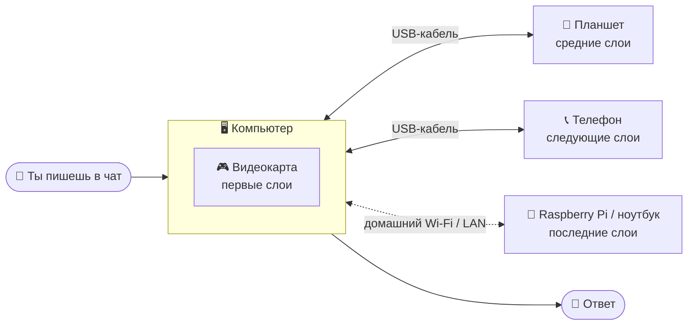
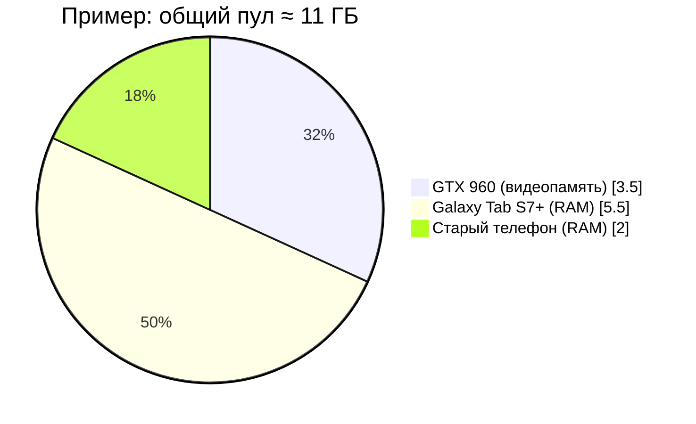
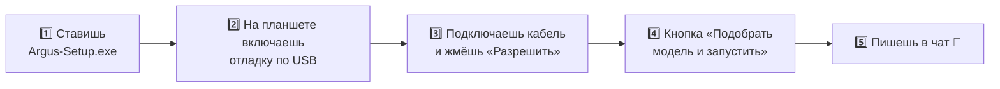
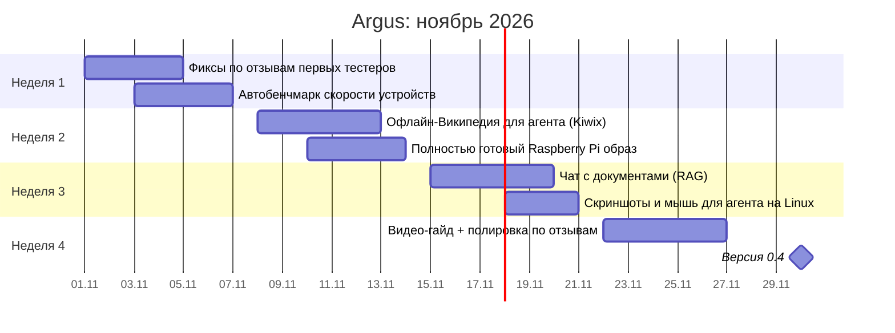

# 👁 ARGUS

### Запусти большую нейросеть на том, что валяется дома

Слабая видюха + старый планшет + телефон из ящика = одна общая нейросеть.

**[⬇ Скачать](../../releases) · [Как это работает](#-как-это-работает) · [Роадмап](#-роадмап-на-месяц) · [❤️ Поддержать](SUPPORT.md)**

---

## 🤔 Зачем это

Нормальная нейросеть хочет 16–24 ГБ видеопамяти. У большинства людей столько нет.
Зато дома почти у всех лежат телефоны и планшеты, в которых по 6–12 ГБ памяти, и они просто пылятся.

**Argus склеивает всё это в одно устройство.** Подключаешь планшет по USB, жмёшь одну кнопку, и модель сама раскладывается по видюхе и всем подключённым устройствам.

> Проект сделан и проверен на GTX 960 на 4 ГБ и Galaxy Tab S7+. Если работает тут, заработает у тебя.

## 🧠 Как это работает

Нейросеть состоит из слоёв, как бутерброд. Argus режет её на куски и отдаёт каждому устройству столько слоёв, сколько у него влезает в память и насколько оно быстрое.
Каждое слово ответа проходит по цепочке через все устройства и возвращается к тебе.

### Откуда берётся память

Одна GTX 960 тянет только маленькие модели на 3–4 миллиарда параметров. Вместе с планшетом в пул влезают модели на **8–14 миллиардов**, а MoE-модели типа Qwen3-30B-A3B вообще летают.

## ⚡ Что умеет

| | |
|---|---|
| 🔌 **USB в один клик** | Подключил, разрешил отладку, и приложение само ставится на планшет и стартует |
| 🧮 **Умное деление** | Модель делится по памяти и скорости каждого устройства, без ручной настройки |
| 🤗 **Модели с Hugging Face** | Поиск прямо в приложении, проверка «влезет ли», кнопка «Скачать и запустить» |
| 💬 **Нормальный чат** | Несколько диалогов, код с подсветкой, стоп, перегенерация, файлы, скорость в tok/s |
| 🤖 **Агент для ПК** | Нейросеть может запускать команды, открывать файлы и программы, кликать мышкой. Каждое действие ты подтверждаешь сам |
| 🛡 **Не падает от кабеля** | Выдернул USB — нода OFFLINE, чат сразу пишет понятную ошибку. Вставил обратно — нода поднимется сама, а модель перезапустится автоматически («Кластер изменился — модель перезапущена»). Кнопки «Переподключить» и «Перезапустить движок» |
| 📶 **Wi-Fi ноды** | Телефон в «Wi-Fi режиме», Linux-ПК или Raspberry Pi (`scripts/argus-node-linux.sh`) сами появляются в «Найдено в сети». Остальное — по IP |
| 🐧 **Linux** | Argus для Linux: AppImage и .deb (Vulkan), модели в `~/.local/share/argus/models` |
| 🚀 **Ускорение** | Отдельные сборки движка под новые процессоры телефонов (в 0.2 скорость выросла **в 2 раза**), speculative decoding, кэш |
| 🔗 **API** | Совместимо с OpenAI API: подключай Open WebUI, Jan, Continue, Hermes |

<table>
<tr>
<td> Быстрый старт и чат</td>
<td> Поиск моделей на Hugging Face</td>
</tr>
<tr>
<td> Агент спрашивает разрешение</td>
<td> Код и форматирование</td>
</tr>
</table>

## 🚀 Как запустить (5 минут)

1. Скачай **Argus-Setup.exe** (Windows) или **AppImage / .deb** (Linux) из [релизов](../../releases) и установи. Всё нужное уже внутри.
2. На планшете: Настройки → О планшете → 7 раз нажми на «Номер сборки» → Параметры разработчика → **Отладка по USB**.
3. Подключи кабель и разреши отладку на экране планшета.
4. В Argus нажми **«Подобрать модель и запустить»**.
5. Когда статус станет **Ready**, пиши в чат.

> Windows может показать предупреждение SmartScreen, потому что установщик не подписан. Жми «Подробнее» → «Выполнить в любом случае».
>
> Linux: нужен драйвер Vulkan (`mesa-vulkan-drivers` или драйвер NVIDIA), а для USB-нод — udev-правила Android: `sudo apt install android-sdk-platform-tools-common`, потом переподключи кабель.
>
> Без кабеля: включи «Wi-Fi режим» в Argus Node, а на Linux-ПК / Raspberry Pi запусти `bash scripts/argus-node-linux.sh` (или `--systemd` для автозапуска) — нода появится в Cluster → «Найдено в сети».

## 🔄 Обновления

Argus **никогда не обновляется сам** — только после твоего «Обновить».

- **Программа на ПК.** При запуске и раз в 6 часов Argus смотрит последний релиз на GitHub. Если вышла новая версия, появится окно
  **«Доступна версия X. Хотите обновить?»** с описанием изменений и кнопками **Обновить / Позже / Пропустить эту версию**.
  «Позже» — спросит при следующем запуске, «Пропустить» — не спросит про эту версию, но спросит про следующую.
  После «Обновить» установщик скачивается с полосой прогресса, проверяется по **SHA-256** (если контрольная сумма не сошлась
  или её нет в релизе — обновление отменяется), модель останавливается, Argus ставит новую версию поверх и открывается заново.
  Настройки, ноды и скачанные модели сохраняются. Вручную: кнопка **ⓘ** вверху (или версия в правом нижнем углу) →
  **«Проверить обновления»**; там же выключается **«Проверять обновления»**.
  Linux AppImage обновляется так же (файл заменяется на месте); для .deb откроется страница релиза.
- **USB-ноды.** Если на телефоне/планшете старая Argus Node, Argus спросит **«Обновить ноду на <устройство>?»**.
  До ответа нода работает на старой версии. «Обновить» — новая версия ставится по кабелю, нода переподключается сама.
- **Wi-Fi ноды.** Пока Argus открыт, он раздаёт свежую Argus Node по домашней сети (порт **50055**). У устаревшей ноды в
  Cluster видна плашка **«Нода устарела»** и кнопка **«Обновить по Wi-Fi»** — на самом устройстве появится вопрос
  «Доступна версия X. Хотите обновить?», а потом Android попросит подтвердить установку (это нормально, так устроен Android).
  В Argus Node есть кнопка **«Проверить обновление»**: сначала спрашивает ПК, если его нет рядом — GitHub.
  Первый раз Android попросит разрешить «Установку неизвестных приложений» для Argus Node.

> Windows может спросить про доступ Argus к сети (порт 50055 для Wi-Fi нод) — разреши для частных сетей.

## 📊 Какая модель влезет

| Твой пул памяти | Что запускать | Для чего |
|---|---|---|
| 4–6 ГБ | Qwen3 4B | Простые вопросы, переводы |
| 8–10 ГБ | Qwen3 8B, Hermes 3 8B | Код, агент, нормальные ответы |
| 10–12 ГБ | Qwen2.5-VL 7B | Видит экран, может управлять мышкой |
| 16 ГБ и больше | Qwen3-30B-A3B | Почти как ChatGPT, и быстро |

## 🗺 Роадмап на месяц

- [x] **0.1** USB-кластер, чат, проверка памяти
- [x] **0.2** Ускорение ×2, Hugging Face, агент, ноды по IP, туториал
- [x] **0.3** Стабильность при отключении кабеля (автопереподключение и автоперезапуск модели), Wi-Fi ноды с автопоиском, Argus для Linux, Linux/Pi как нода
- [ ] **Неделя 1** Автобенчмарк: Argus сам замеряет скорость каждого устройства и делит модель точнее
- [ ] **Неделя 2** Офлайн-знания: агент ищет по Википедии и файлам, скачанным на старый телефон, без интернета
- [ ] **Неделя 3** Чат с документами: кидаешь PDF, и нейросеть отвечает по нему
- [ ] **Потом** macOS, агент со скриншотами на Linux, iPhone не обещаю 😅

Сроки примерные: делаю один, в свободное время.

## ❓ Частые вопросы

<b>Это безопасно?</b>

Всё работает у тебя дома, ничего не уходит в интернет. Агент делает только то, что ты подтвердил. Сетевые (Wi-Fi) ноды не защищены паролем, поэтому подключай их только в закрытой домашней сети и никогда не открывай порт 50052 в интернет.

<b>Насколько это быстро?</b>

Медленнее, чем одна мощная видеокарта, зато запускаются модели, которые раньше вообще не влезали. Планшет греется, держи его на зарядке и не под подушкой.

<b>Можно ускорить игры так же?</b>

Нет. Игре нужен кадр каждые 10–15 мс, кабель столько не вытянет. Нейросети можно делить, потому что слова идут медленно.

<b>Что будет, если случайно выдернуть кабель?</b>

Нода станет OFFLINE, движок остановится, а в чате появится «Генерация прервана: нода … отключилась» вместо вечного ожидания. Вставь кабель обратно — Argus сам подготовит ноду на том же порту и через пару секунд перезапустит модель. Перезапускать программу не нужно.

<b>Нужен ли root?</b>

Нет. Обычное приложение и отладка по USB.

## 🛠 Для разработчиков

Архитектура, сборка и все технические детали: [docs/ARCHITECTURE.md](docs/ARCHITECTURE.md).
Стек: Tauri (Rust + React/TS), Kotlin, llama.cpp b12008 (`llama-server --rpc` + `rpc-server`).

## ❤️ Поддержать

Делаю Argus один на GTX 960. Если проект зашёл, [вот тут можно помочь](SUPPORT.md), а твой ник попадёт в «Сердце проекта».

Сделано из старого железа и упрямства 👁

